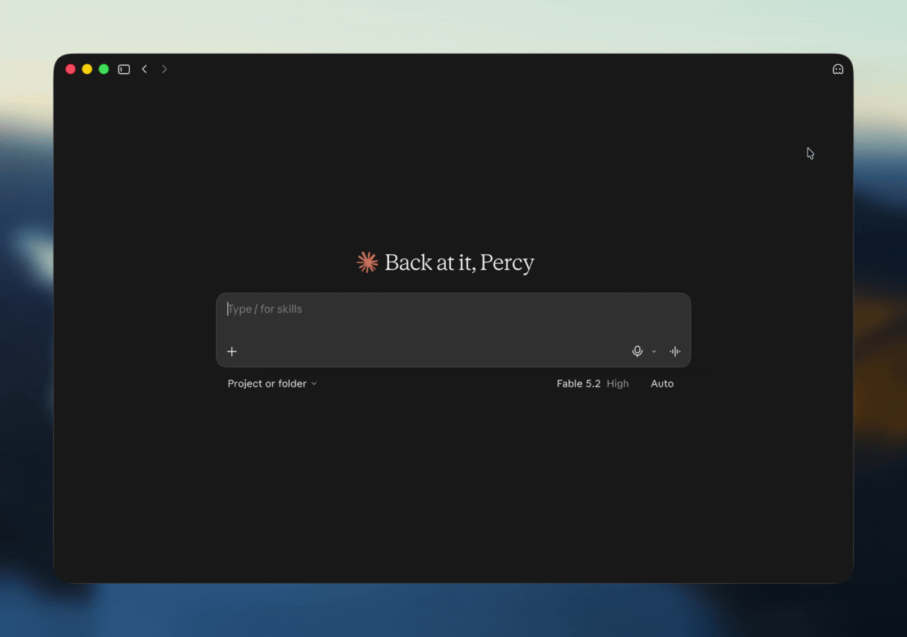
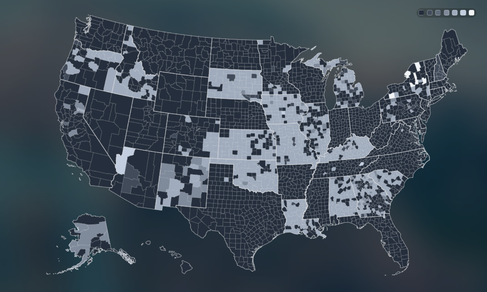

<h1 align="center"> L3R MCP Server</h1>

<p align="center"><a href="https://lobehub.com/mcp/l3r-ai-l3r-mcp"></a></p>

<br>

<p align="center">
  
</p>

<p align="center">Ask about US property, cities, and energy. No account required.</p>

<p align="center">
  <a href="https://claude.ai/directory/l3r"></a>
  <a href="https://cursor.com/en/install-mcp?name=l3r&config=eyJ1cmwiOiJodHRwczovL21jcC5sM3IuaW8vbWNwIn0="></a>
  <a href="https://vscode.dev/redirect/mcp/install?name=l3r&config=%7B%22type%22%3A%22http%22%2C%22url%22%3A%22https%3A%2F%2Fmcp.l3r.io%2Fmcp%22%7D"></a>
  <a href="#codex"></a>
</p>

## Data catalog

| | Includes |
|---|---|
| **Property** | Type, buildings, floors, size, year built, official name, parcel number, a photo, a stable L3R key |
| **Place** | Census tract and 2020 to 2024 figures; congressional, legislative, school districts |
| **Zoning** | District from the official map, with its rules and overlays where held |
| **Map** | The lot among nearby lots, buildings, streets, zoning |
| **Risk and site** | FEMA hazard ratings, EPA cleanup sites, wetlands, protected areas, sewer |
| **Nearby** | Water, roads, rail, airports, ports, power plants, EV charging, data centers |
| **Energy** | Grid, utilities, plant output, coal deliveries, state prices, hourly demand, power flows, building benchmarking |
| **Data centers** | Projects backed by permits, zoning cases and other official records |
| **City records** | Permits, code cases, council votes, ordinances, municipal code, new developments, rezonings and landmarks, budgets, projects, affordable and public housing, property tax rates (Texas, Florida, Maryland, New Jersey, Tennessee) |

Each answer is a short Markdown card plus the full JSON.

## Connect

```text
https://mcp.l3r.io/mcp
```

### Claude

Add from [connector directory](https://claude.ai/directory/l3r) (listing description pending update), or add a custom connector with URL.

#### Claude Code

```sh
claude mcp add --transport http l3r https://mcp.l3r.io/mcp
```

### ChatGPT

Turn on Developer mode, then add a connector with URL and no authentication.

#### Codex

```sh
codex mcp add l3r --url https://mcp.l3r.io/mcp
```

### Other clients

Add URL as a streamable HTTP server:

```json
{ "mcpServers": { "l3r": { "url": "https://mcp.l3r.io/mcp" } } }
```

<details>
<summary>Where each client keeps it</summary>

| Client | Config |
|---|---|
| Cursor | `~/.cursor/mcp.json`, or the button above |
| VS Code | The button above, or `.vscode/mcp.json` |
| Windsurf | `~/.codeium/windsurf/mcp_config.json` |
| Gemini CLI | `~/.gemini/settings.json` |
| Zed | `settings.json`, under `context_servers` |

</details>

Code examples: [Python](examples/python/lookup.py), [TypeScript](examples/typescript/lookup.ts), [curl](examples/curl/examples.sh).

## Try it

<details>
<summary>Example questions</summary>

- **Building:** "How many units are in 432 Park Ave in New York?"
- **Census:** "What's the median rent around Ponce City Market in Atlanta?"
- **Zoning:** "What does RS-3 zoning allow in Tulsa?"
- **Hazards:** "What are the wildfire and earthquake risks at the Getty Center in Los Angeles?"
- **Nearby:** "What rail lines, airports and EV chargers are near Union Station in Kansas City?"
- **Site screen:** "Are there wetlands or contaminated sites near 1 Canal St in New Orleans?"
- **Energy service:** "Which companies supply electricity and gas at 870 Santa Cruz Ave in Menlo Park?"
- **Districts:** "Which congressional and school districts is 200 E Colfax Ave in Denver in?"
- **Data center projects:** "What is the status of the Prince William Digital Gateway in Virginia?"
- **Power plant:** "How much power did the W A Parish plant generate last year, and from what fuels?"
- **Coal:** "Which mines supply coal to the Labadie plant in Missouri?"
- **State electricity:** "What do homes in Maine pay for electricity?"
- **Grid demand:** "What were ERCOT's demand and fuel mix over the last day?"
- **Grid flows:** "How much power does the California ISO import from its neighbours?"
- **Facility:** "Tell me about the Hoover Dam power plant."
- **City records:** "What zoning hearings are coming up in Dallas, and who decides them?"
- **Council:** "How did San Francisco's supervisors vote on recent housing items?"
- **Affordable:** "Who are the biggest affordable housing developers in San Francisco?"
- **Texas affordable:** "How many housing tax credit awards has Houston had in recent years?"
- **Town budget:** "What does Highland Park, TX spend on police?"
- **Capital projects:** "What capital projects is Seattle funding this year?"
- **Projects:** "What's in review at 3908 Menchaca Rd in Austin?"
- **Development:** "What's been built around Rainey Street in Austin, and how tall?"
- **Public housing:** "What repairs does NYCHA plan at Red Hook Houses?"
- **Ordinances:** "What new housing laws has New York City passed?"
- **Code:** "Is San Francisco changing its ceiling height rules?"
- **New developments:** "What's being built in San Francisco right now?"
- **Rezonings:** "What's being rezoned in Brooklyn?"
- **Energy:** "Is 350 Fifth Ave over its Local Law 97 limits?"
- **Minerals:** "What is produced on federal land in Eddy County, NM?"

</details>

## Tools

| Tool | Returns |
|---|---|
| [`property_profile`](docs/tools.md#property_profile) | Everything about a property in one card. |
| [`lookup_property`](docs/tools.md#lookup_property) | Property type, building facts, parcel and location for an address. |
| [`show_property_map`](docs/tools.md#show_property_map) | Map picture of the lot with nearby buildings, streets and zoning. |
| [`show_property_photo`](docs/tools.md#show_property_photo) | Street photo of the property, or an aerial of the lot. |
| [`census_for_area`](docs/tools.md#census_for_area) | Population, income, home value and rent for an area. |
| [`zoning_for_property`](docs/tools.md#zoning_for_property) | Zoning district from the official map, with its rules where held. |
| [`zoning_table_for_city`](docs/tools.md#zoning_table_for_city) | Zoning districts and their rules, for 185 cities. |
| [`hazards_for_property`](docs/tools.md#hazards_for_property) | FEMA hazard ratings and EPA cleanup sites within a mile. |
| [`nearby_for_property`](docs/tools.md#nearby_for_property) | Utilities, transport, energy, schools and EV charging nearby. |
| [`site_screen_for_property`](docs/tools.md#site_screen_for_property) | Wetlands, protected areas, contamination and sewer service. |
| [`energy_service_for_property`](docs/tools.md#energy_service_for_property) | Grid, electric utility, retail supplier and gas utility. |
| [`districts_for_property`](docs/tools.md#districts_for_property) | House, state legislature and school districts for a property. |
| [`data_center_projects`](docs/tools.md#data_center_projects) | Data center projects from official records, dated and linked. |
| [`energy_plant_history`](docs/tools.md#energy_plant_history) | Monthly and annual generation and fuel mix for a power plant. |
| [`electricity_state_profile`](docs/tools.md#electricity_state_profile) | State electricity prices, sales, customers and CO2. |
| [`grid_demand_mix`](docs/tools.md#grid_demand_mix) | Hourly demand, forecast and fuel mix for a grid region. |
| [`grid_interchange`](docs/tools.md#grid_interchange) | Hourly electricity flows between balancing authorities. |
| [`coal_shipments`](docs/tools.md#coal_shipments) | Coal received at a plant by mine, or shipped from a mine. |
| [`mineral_production`](docs/tools.md#mineral_production) | Mineral output and revenue from federal and tribal lands. |
| [`lookup_facility`](docs/tools.md#lookup_facility) | A power plant, airport, port or hospital by name or ID. |
| [`coverage_for_county`](docs/tools.md#coverage_for_county) | What L3R holds for a county. |
| [`list_reference_data`](docs/tools.md#list_reference_data) | Ranked lists of seaports, risk tracts or power plants. |
| [`city_hall_for_place`](docs/tools.md#city_hall_for_place) | Hearings, decisions, boards and town budgets for a city. |
| [`projects_for_property`](docs/tools.md#projects_for_property) | Planning cases, permits and development for an address or area. |
| [`municipal_for_property`](docs/tools.md#municipal_for_property) | Who governs a property, who represents it, and who decides. |
| [`affordable_for_place`](docs/tools.md#affordable_for_place) | Affordable housing for a city: sponsors, funding and pipeline. |
| [`ordinances_for_place`](docs/tools.md#ordinances_for_place) | New ordinances and local laws for SF, NYC and 10 more cities. |
| [`municipal_code_for_place`](docs/tools.md#municipal_code_for_place) | Search the code of about 500 cities and counties. |
| [`developments_for_place`](docs/tools.md#developments_for_place) | New housing projects in SF and NYC by stage. |
| [`land_use_changes_for_place`](docs/tools.md#land_use_changes_for_place) | Rezonings and landmark designations in SF and NYC. |
| [`energy_benchmarking_for_property`](docs/tools.md#energy_benchmarking_for_property) | A building's energy and emissions against its peers. |
| [`energy_benchmarking_for_place`](docs/tools.md#energy_benchmarking_for_place) | Energy benchmarking and Local Law 97 across NYC or SF. |

All tools are read-only. Schemas and example responses are in the [tools reference](docs/tools.md).

## Coverage & limits

This is L3R's public slice. Facts appear only where publishers allow, so a missing value often isn't licensed for display yet. [Athena](https://3drights.com) covers full records, including permit history and rights.

<p align="center">
  
  <br><sub><em>Darker counties are keyed for property lookup; lighter ones have a county source and are being keyed.</em></sub>
</p>

<details>
<summary>Limits</summary>

- **Parcels:** 119M+ properties in 2,100+ US counties. Census figures for all 50 states, DC and Puerto Rico.
- **Ranches and farms:** shown one tax parcel at a time; a holding's other parcels aren't linked.
- **Hazards:** FEMA ratings by Census tract, not parcel. Flood zones only where held (San Francisco for now).
- **Site screen:** a first look only. Layers we don't hold are named, never shown as clear.
- **Energy service:** confirmed where a state map covers the address; otherwise likely, by county.
- **Districts:** names and numbers only. Election offices decide.
- **Grid:** hourly figures, refreshed daily, not live.
- **Ordinances:** San Francisco, New York City, Seattle, Denver, Boston, Oakland, Pittsburgh, Columbus, Cleveland, Corpus Christi, Round Rock and League City. Sponsors, votes and summaries for SF and NYC only.
- **Rezonings and landmarks, energy benchmarking:** San Francisco and New York City for now.
- **Local Law 97:** an estimate from reported benchmarking, not a DOB determination.
- **Rate limit:** one address per call; 60 calls an hour and 300 a day from each network address.

</details>

<details>
<summary>Property types</summary>

| Type | Includes |
|---|---|
| Single-family home | Detached and attached houses |
| Multifamily building | Two units or more, from duplexes to large apartment buildings |
| Condominium | Condo buildings and their units |
| Mixed-use building | Homes and businesses in one building |
| Manufactured | Manufactured and mobile homes |
| Office building | Offices |
| Retail property | Shops, restaurants, shopping centers |
| Commercial property | Hotels, parking and other commercial uses |
| Industrial property | Factories, warehouses, utilities |
| Government or institutional property | Public buildings, schools, hospitals, churches |
| Agricultural land | Farms, ranches, timber |
| Vacant land | Undeveloped lots and tracts |

*Types come from each county's land-use code; if a county has none, the type is left out.*

</details>

<details>
<summary>Facilities</summary>

| Group | Includes |
|---|---|
| Power | Power plants, nuclear plants, hydropower projects, wind turbines, large solar arrays |
| Fuel and gas | Refineries, petroleum terminals, LNG terminals, gas storage fields, offshore platforms, CO2 storage |
| Data centers | Data center sites backed by official records |
| Transport | Airports, ports, intermodal rail terminals, spaceports |
| Water | Community water systems, wastewater plants, dams |
| Mining | Mines, quarries and mineral deposits |
| Public | Public schools, hospitals, federal property |
| Emissions | Toxics release and greenhouse gas reporting facilities |
| Towers | Antenna structures |

*Facilities come from federal and state registries (EIA, NRC, FERC, FAA, EPA and others), each credited on its card.*

</details>

<details>
<summary>City records</summary>

| Record | Where |
|---|---|
| Permits | About 120 cities and counties, plus New Jersey statewide |
| City&nbsp;hall | Austin, Baltimore, Boston, Chicago, Columbus, Dallas, Houston, Jacksonville, Los Angeles, Memphis, Miami, New York City, Oklahoma City, Philadelphia, Portland, San Diego, San Francisco, Seattle, 190+ smaller cities and towns |
| Ordinances | San Francisco, New York City (with agency rules), Seattle, Denver, Boston, Oakland, Pittsburgh, Columbus, Cleveland, Corpus Christi, Round Rock and League City, read daily |
| Rezonings | San Francisco, New York City |
| Landmarks | San Francisco, New York City |
| Energy&nbsp;use | San Francisco, New York City |
| Development | Aspen, Atlanta, Austin, Beverly Hills, Boston, Charlotte, Dallas, Denver, Fort Worth, Las Vegas, Los Angeles, Miami, Minneapolis, Nashville, New York City, Orlando, Philadelphia, Portland, San Antonio, San Diego, Seattle, Washington DC |

</details>

<details>
<summary>Municipal code</summary>

| Code | Where |
|---|---|
| Code&nbsp;text | About 500 cities and counties |
| Zoning&nbsp;maps | About 950 cities and counties |
| District&nbsp;rules | Abilene, Albuquerque, Alexandria, Allen, Amarillo, Anaheim, Anchorage, Arlington, Arlington County, Aspen, Atlanta, Austin, Baltimore, Baltimore County, Beaumont, Berkeley, Beverly Hills, Birmingham, Boise, Boston, Brownsville, Buffalo, Burbank, Cape Coral, Carlsbad, Carroll County (MD), Catawba County, Centennial, Chandler, Charleston (SC), Charlotte, Chicago, Cincinnati, Clark County, Clearwater, Cleveland, College Station, Columbus, Coral Springs, Corona, Corpus Christi, Costa Mesa, Culver City, Dallas, Del Mar, Denver, Detroit, DuPage County, Durham, El Monte, El Paso, Escondido, Fargo, Fayetteville (AR), Fishers, Fontana, Fort Lauderdale, Fort Myers, Fort Worth, Franklin County (OH), Fremont, Fresno, Frisco, Fullerton, Garden Grove, Gilbert, Glendale, Grand Prairie, Grand Rapids, Hayward, Henderson, Henrico County, Hialeah, Highland Park, Hillsborough County, Hollywood, Honolulu, Huntington Beach, Huntsville, Indianapolis, Inglewood, Irvine, Irving, Jefferson County (AL), Jersey City, Jurupa Valley, Kansas City, King County, Laredo, LaSalle County, League City, Lexington, Long Beach, Los Angeles, Los Angeles County, Los Gatos, Loudoun County, Lubbock, Madison, Malibu, Maricopa County, McAllen, McKinney, Memphis, Menlo Park, Mesa, Mesquite, Miami, Miami-Dade County, Milwaukee, Miramar, Mobile, Modesto, Mountain View, Multnomah County, New Orleans, New York City, Newport Beach, Oakland, Oklahoma City, Omaha, Orange, Orange County, Orlando, Palm Coast, Palmdale, Palo Alto, Pasadena, Philadelphia, Pittsburgh, Plano, Pompano Beach, Port St. Lucie, Portland, Prosper, Raleigh, Rancho Cucamonga, Redwood City, Richmond (CA), Richmond (VA), Riverside County, Round Rock, Sacramento, Salinas, Salt Lake City, San Angelo, San Antonio, San Diego, San Francisco, San Jose, San Mateo, Santa Barbara, Santa Clara, Santa Monica, Sarpy County, Seattle, Simi Valley, Spokane, St. Petersburg, Stockton, Sugar Land, Sunnyvale, Tacoma, Tallahassee, Tampa, Telluride, Tempe, Thousand Oaks, Toledo, Torrance, Tucson, Tulsa, University Park, Upland, Utah County, Vallejo, Ventura County, Waco, Wake County, Walnut Creek, Washington DC, West Covina, West Hollywood, Whittier, Wichita |

</details>

<br>

See [what L3R leaves out](docs/left-out.md).

## Attribution

<details>
<summary>Credit</summary>

Each answer ends with a short source line. Please show it with the result, for example:

> From Athena by L3R (PROP-…). Sources: Texas GIO, USA Structures (CC BY 4.0), Travis CAD, Census ACS 2020 to 2024.

Where Census figures appear, also show:

> This product uses the Census Bureau Data API but is not endorsed or certified by the Census Bureau.

Full credits are in each answer's `attribution` field.

</details>

<details>
<summary>Sources</summary>

- **Parcels and buildings:** county assessors, state GIS offices, city open data, USA Structures (CC BY 4.0)
- **Building names:** city landmark commissions, National Register of Historic Places, GSA
- **Zoning:** city and county maps and codes
- **Permits:** city and county building departments and open data portals
- **Census:** ACS 2020 to 2024 5-year estimates, Census Geocoder
- **Districts:** Census TIGER/Line
- **Hazards:** FEMA National Risk Index, EPA cleanup sites
- **Site screen:** USFWS, USGS, FEMA, EPA
- **Nearby:** EIA, EPA, FAA, NCES, CMS, DOE AFDC (NLR data, no endorsement implied)
- **Energy service:** EIA via Catalyst Cooperative PUDL (CC BY 4.0)
- **Power plants and grid:** EIA (public domain)
- **Data center projects:** official public records, each linked
- **City records:** city open data, clerks and councils, budgets, landmark reports
- **Development and parks:** city building, planning and parks departments
- **Affordable and public housing:** HUD, state and city housing agencies, public housing authorities
- **Ordinances:** SF Board of Supervisors, NYC Council, NYC Rules, sf.gov, each other city's Legistar record
- **Rezonings and landmarks:** NYC DCP Zoning Application Portal, NYC Council, Landmarks Preservation Commission, SF Historic Preservation Commission
- **Energy benchmarking:** NYC LL84 and DOB Local Law 97 list, SF Existing Buildings Ordinance, EPA Greenhouse Gas Equivalencies
- **Minerals:** Office of Natural Resources Revenue (ONRR)

</details>

## Contact

Questions: [mcp@l3r.io](mailto:mcp@l3r.io) or [open an issue](../../issues).

[Terms](TERMS.md) | [Privacy](PRIVACY.md) | [Security](SECURITY.md)

---

Built by L3R, Real Property Intelligence
