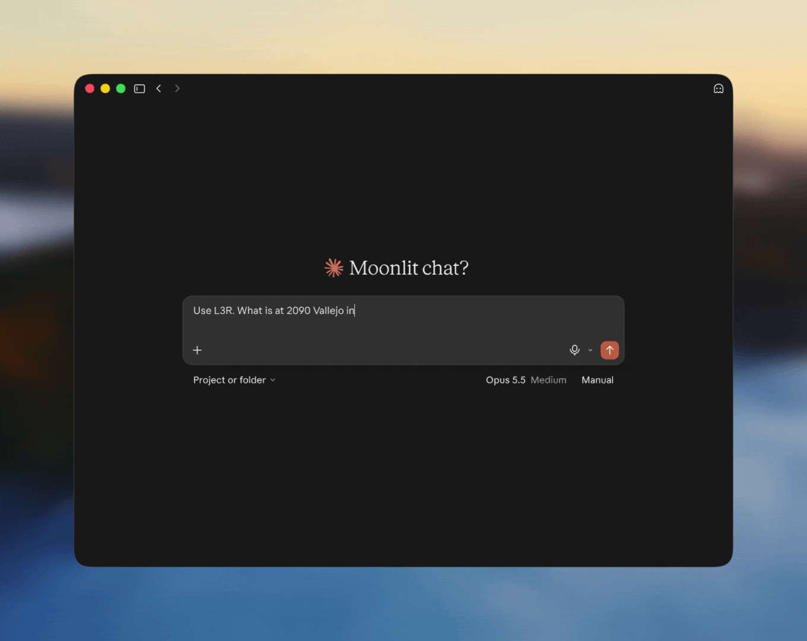

#  L3R MCP Server

Real property intelligence for Claude, ChatGPT and other AI agents.

<p align="center">
  
</p>

Facts for any US address or parcel number, plus US power plant and grid data:

1. **What's there:** property type, buildings, floors, size, year built and official name.
2. **Which parcel:** the county parcel number and a stable L3R property key.
3. **Where it is:** location, Census tract, place and county, with 2020–2024 figures.
4. **Zoning:** the district from the official map, with its rules where held.
5. **Hazards:** FEMA hazard ratings and nearby EPA cleanup sites.
6. **Nearby:** water, roads, rail, airports, ports, power plants, EV charging and data centers.
7. **Site screen:** wetlands, protected areas, contamination and sewer service.
8. **Energy service:** the grid, electric utility and gas utility.
9. **Districts:** congressional, state legislative and school districts.
10. **Data center projects:** projects backed by official records.
11. **Power plants:** generation history and coal deliveries.
12. **Electricity:** state prices and emissions, and hourly grid demand and flows.

Each answer comes as a short Markdown card plus the full JSON. Free, read-only, no account.

```text
https://mcp.l3r.io/mcp
```

## Connect

**Claude:** add it from the [connector directory](https://claude.ai/directory/l3r), or add a custom connector with the URL.

**Claude Code:**

```sh
claude mcp add --transport http l3r https://mcp.l3r.io/mcp
```

**ChatGPT:** turn on Developer mode, then add a connector with the URL and no authentication.

**Other clients:** add the URL as a streamable HTTP server.

```json
{ "mcpServers": { "l3r": { "url": "https://mcp.l3r.io/mcp" } } }
```

Code examples: [Python](examples/python/lookup.py), [TypeScript](examples/typescript/lookup.ts), [curl](examples/curl/examples.sh).

## Example questions

- **Single-family home:** "Is 710 Steiner St in San Francisco a single-family home, and what year was it built?"
- **Condo:** "How many units are in 432 Park Ave in New York?"
- **Apartments:** "What kind of property is 300 N State St in Chicago?"
- **Retail:** "What's at 2623 NE University Village St in Seattle?"
- **Parcel number:** "What's the parcel number for 401 Congress Ave in Austin?"
- **Office tower:** "How tall is 1 S Broad St in Philadelphia, and when was it built?"
- **Census:** "What's the median rent around Ponce City Market in Atlanta?"
- **Zoning:** "What does RS-3 zoning allow in Tulsa?"
- **Hazards:** "What are the wildfire and earthquake risks at the Getty Center in Los Angeles?"
- **Nearby:** "What rail lines, airports and EV chargers are near Union Station in Kansas City?"
- **Site screen:** "Are there wetlands or contaminated sites near 1 Canal St in New Orleans?"
- **Energy service:** "Which companies supply electricity and gas at 870 Santa Cruz Ave in Menlo Park?"
- **Districts:** "Which congressional and school districts is 200 E Colfax Ave in Denver in?"
- **Data center projects:** "What is the status of the Prince William Digital Gateway in Virginia?"
- **Power plant:** "How much power did the W A Parish plant generate last year, and from what fuels?"
- **Coal:** "Which mines supply coal to the Labadie plant in Missouri?"
- **State electricity:** "What do homes in Maine pay for electricity?"
- **Grid demand:** "What is ERCOT's demand right now, and what is the fuel mix?"
- **Grid flows:** "How much power does the California ISO import from its neighbours?"
- **Facility:** "Tell me about the Hoover Dam power plant."

## Tools

| Tool | What it does |
|---|---|
| [`lookup_property`](docs/tools.md#lookup_property) | Property type, building facts, parcel and location for an address. |
| [`census_for_area`](docs/tools.md#census_for_area) | Population, income, home value and rent for an area. |
| [`zoning_for_property`](docs/tools.md#zoning_for_property) | Zoning district from the official map, with its rules where held. |
| [`hazards_for_property`](docs/tools.md#hazards_for_property) | FEMA hazard ratings and EPA cleanup sites within a mile. |
| [`nearby_for_property`](docs/tools.md#nearby_for_property) | Utilities, transport, energy, schools and EV charging nearby. |
| [`site_screen_for_property`](docs/tools.md#site_screen_for_property) | Wetlands, protected areas, contamination and sewer service. |
| [`energy_service_for_property`](docs/tools.md#energy_service_for_property) | Grid, electric utility, retail supplier and gas utility. |
| [`districts_for_property`](docs/tools.md#districts_for_property) | U.S. House, state legislature and school districts for a property or point. |
| [`data_center_projects`](docs/tools.md#data_center_projects) | Data center projects backed by official records, each dated and linked. |
| [`energy_plant_history`](docs/tools.md#energy_plant_history) | Monthly and annual generation and fuel mix for a power plant. |
| [`electricity_state_profile`](docs/tools.md#electricity_state_profile) | State electricity prices, sales, customers and CO2. |
| [`grid_demand_mix`](docs/tools.md#grid_demand_mix) | Hourly demand, forecast, generation and fuel mix for a balancing authority. |
| [`grid_interchange`](docs/tools.md#grid_interchange) | Hourly electricity flows between balancing authorities. |
| [`coal_shipments`](docs/tools.md#coal_shipments) | Coal received at a plant by mine, or shipped from a mine. |
| [`lookup_facility`](docs/tools.md#lookup_facility) | A power plant, airport, port or hospital by name or ID. |
| [`coverage_for_county`](docs/tools.md#coverage_for_county) | What L3R holds for a county: parcels, zoning, rules, flood, wells and data center projects. |
| [`list_reference_data`](docs/tools.md#list_reference_data) | Ranked lists of strategic seaports, FEMA risk tracts or power plants. |

All tools are read-only. Schemas and example responses are in the [tools reference](docs/tools.md).

## Coverage and limits

- **Parcels:** about 125 million properties in 2,236 of 3,222 US counties.
- **Census:** all 50 states, DC and Puerto Rico.
- **Building facts:** county assessor data, NYC PLUTO, the SF Assessor and USA Structures.
- **Building names:** NYC Landmarks, the National Register and the GSA.
- **Zoning:** official city and county maps, with district rules for some cities.
- **Hazards:** FEMA ratings by Census tract, not by parcel. Flood zones are not included yet.
- **Site screen:** a first look only. Layers we don't hold are named, never shown as clear.
- **Energy service:** confirmed where a state map covers the address; otherwise likely, by county.
- **Districts:** Census boundaries, names and numbers only. Election offices decide.
- **Data center projects:** official records only, such as permits and zoning cases. News never counts.
- **Power plants and electricity:** EIA data. Grid figures are refreshed daily, not live.
- **Not returned:** owners, values, sales or parcel outlines.
- **Rate limit:** one address per call; 60 calls an hour and 300 a day from each network address.

Coverage grows as L3R adds sources. L3R shows a fact only where the publisher's terms allow it, so a missing value often means it isn't licensed for display here yet, not that it doesn't exist.

Municipal code, permits and rights are handled by [Athena](https://3drights.com), L3R's property expert; still in private development.

## Attribution

Each answer ends with a short source line. Please show it with the result, for example:

> From Athena by L3R (PROP-…). Sources: Texas GIO, USA Structures (CC BY 4.0), Travis CAD, Census ACS 2020–24.

Where Census figures appear, also show:

> This product uses the Census Bureau Data API but is not endorsed or certified by the Census Bureau.

Full credits are in each answer's `attribution` field.

<details>
<summary><b>Sources</b></summary>

- **Parcels and buildings:** county parcel and assessor records, Texas GIO (CC0), NYC PLUTO, the San Francisco Assessor (PDDL), and USA Structures from FEMA and Oak Ridge National Laboratory (CC BY 4.0).
- **Building names:** NYC Landmarks, the National Register of Historic Places and the GSA.
- **Census:** U.S. Census Bureau, 2020–2024 ACS 5-year estimates and the Census Geocoder.
- **Zoning:** official city and county zoning maps and codes, credited to each publisher.
- **Hazards:** FEMA National Risk Index and EPA cleanup sites.
- **Site screen:** USFWS National Wetlands Inventory, USGS PAD-US, EPA cleanup and underground tank records, and where held FEMA flood maps and USGS 3DEP.
- **Energy service:** EIA-861 and EIA-860 via Catalyst Cooperative PUDL (CC BY 4.0), and the official pages of community choice programs.
- **Districts:** Census TIGER/Line.
- **Data center projects:** official public records, each linked.
- **Plants, state electricity and coal:** U.S. Energy Information Administration (EIA-860M, EIA-923, EIA-861 and State Electricity Profiles; public domain).
- **Grid demand and interchange:** U.S. Energy Information Administration, EIA-930 Hourly Electric Grid Monitor (public domain).
- **Nearby and facilities:** EIA, EPA, FAA, NCES and CMS records, and the DOE Alternative Fuels Data Center (NLR data; no endorsement implied).

</details>

<details>
<summary><b>Contact</b></summary>

- Feedback: [feedback@l3r.io](mailto:feedback@l3r.io) or [open an issue](../../issues)
- Questions: [mcp@l3r.io](mailto:mcp@l3r.io)

</details>

<details>
<summary><b>Legal</b></summary>

- [Terms of use](TERMS.md)
- [Privacy](PRIVACY.md)
- [Security](SECURITY.md)

</details>

---

Built by L3R.
